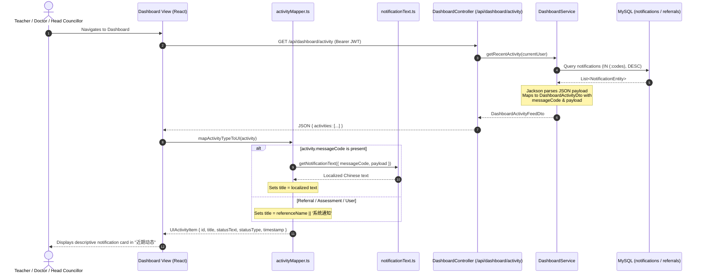

# Technical & Domain Architecture: Dashboard Recent Activity Notification Resolution

## 1. Executive Summary & Root Cause

### 1.1 Problem Statement
On user dashboards across all roles (Teachers, Head Councillors, Trial Admins, Doctors), the "Recent Activity" (`近期动态`) feed displays the ambiguous generic text `"系统通知"` for notification-based activity items (e.g. high-risk assessment triggers, referral updates, unread alerts).

### 1.2 Root Cause
1. **DTO Truncation**: `DashboardActivityDto` only contained `referenceId` and `referenceName: String?`. When `DashboardService` projected `NotificationEntity`, it set `referenceName = null` because notifications do not have a scalar name attribute.
2. **Missing Notification Context**: The entity's `messageCode` (enum) and JSON-serialized `payload` were omitted from `/api/dashboard/activity`.
3. **Teacher Query Limitation**: The Teacher high-risk JPQL query in `DashboardService.kt` only queried `ASSESSMENT_COMPLETED_TEACHER`, failing to include high-priority `ASSESSMENT_HIGH_RISK_ALERT_TEACHER` notifications.
4. **Presentation Coupling**: In the frontend, localized message formatting was tightly encapsulated inside `NotificationsView.tsx`. `activityMapper.ts` could not resolve notification texts and defaulted to `activity.referenceName || '系统通知'`.

### 1.3 Architectural Invariant: Language-Agnostic Backend
Per the architecture rules in `GEMINI.md`:
> **No Presentation Strings in Backend**: The backend MUST remain strictly language-agnostic. Never create string `message` fields in DTOs intended for direct frontend display (e.g. Chinese toasts/labels). Use booleans, enums, or IDs instead, and let the frontend define the localized UI text.

To respect this invariant, the backend will **not** render or return pre-formatted Chinese messages. Instead, it will project `messageCode: String?` (enum name) and `payload: Map<String, Any>?`, allowing the frontend to resolve localized strings via a shared pure formatter.

---

## 2. Bounded Contexts & CQRS Read Model Architecture

In Domain-Driven Design (DDD), **Dashboard is NOT an aggregate root**; it is an **Application-Level Projection / Read Model (CQRS Query Service)** aggregating across 4 Bounded Contexts:

| Bounded Context | Aggregate Root / Entities | Role in Dashboard Projection |
| :--- | :--- | :--- |
| **Notification Context** | `Notification` (`NotificationMessageCode`, `NotificationActionType`) | Informs users of asynchronous domain events, state updates, and actionable alerts. |
| **Referral Context** | `Referral`, `ReferralStep` | Active triage, scheduling, feedback, and student referral lifecycle progress. |
| **Assessment Context** | `AssessmentAssignment` | Student completion tasks and psychological evaluation progress. |
| **User & Identity Context** | `User`, Role entities (`Teacher`, `Doctor`, etc.) | Identity profiles and pending account approvals. |



---

## 3. Detailed Component Contracts & Technical Design

### 3.1 Backend DTO Contract

**File**: `backend/src/main/kotlin/com/medicalsystem/backend/dto/DashboardActivityDto.kt`

```kotlin
package com.medicalsystem.backend.dto

import java.time.Instant

enum class ActivityType {
    REFERRAL_PENDING_TRIAGE,
    REFERRAL_PENDING_SCHEDULING,
    REFERRAL_PENDING_FEEDBACK,
    REFERRAL_STATUS_UPDATED,
    
    ASSESSMENT_PENDING_COMPLETION,
    HIGH_RISK_ASSESSMENT_SUBMITTED,
    
    USER_APPROVAL_PENDING,
    
    UNREAD_NOTIFICATION,
    SYSTEM_NOTIFICATION,
    HOSPITAL_CAPACITY_ALERT
}

data class DashboardActivityDto(
    val id: String,
    val type: ActivityType,
    val timestamp: Instant,
    val referenceId: Long,
    val referenceName: String? = null,
    val messageCode: String? = null,
    val payload: Map<String, Any>? = null
)

data class DashboardActivityFeedDto(
    val activities: List<DashboardActivityDto>
)
```

### 3.2 Backend Service Refactoring

**File**: `backend/src/main/kotlin/com/medicalsystem/backend/service/DashboardService.kt`

#### Safe Jackson Deserialization Helper:
```kotlin
private fun parsePayload(json: String?): Map<String, Any>? {
    if (json.isNullOrBlank()) return null
    return try {
        val typeRef = object : com.fasterxml.jackson.core.type.TypeReference<Map<String, Any>>() {}
        objectMapper.readValue(json, typeRef)
    } catch (e: Exception) {
        logger.warn("Failed to deserialize notification payload: {}", json, e)
        null
    }
}
```

#### Branch-by-Branch Mapping Updates in `getRecentActivity(user: User)`:
1. **Teacher**:
   Query both `ASSESSMENT_HIGH_RISK_ALERT_TEACHER` and `ASSESSMENT_COMPLETED_TEACHER`.
   Attach `messageCode = it.messageCode.name` and `payload = parsePayload(it.payload)`.
2. **Head Councillor**:
   Attach `messageCode = it.messageCode.name` and `payload = parsePayload(it.payload)` on high-risk and unread system notifications.
3. **Trial Admin & Doctor**:
   Attach `messageCode = it.messageCode.name` and `payload = parsePayload(it.payload)` on unread notifications.

### 3.3 Frontend API Type Contract

**File**: `frontend/src/api/dashboard.ts`

```typescript
export interface DashboardActivityDto {
  id: string;
  type: ActivityType;
  timestamp: string;
  referenceId: number;
  referenceName?: string | null;
  messageCode?: string;
  payload?: Record<string, any>;
}
```

### 3.4 Shared Notification Formatter Module

**New File**: `frontend/src/utils/notificationText.ts`

Pure, framework-agnostic function returning `string`:
```typescript
export interface NotificationTextParams {
  messageCode?: string;
  payload?: Record<string, any>;
}

export function getNotificationText(notification: NotificationTextParams): string {
  // Pure string resolution of all NotificationMessageCode values matching PRD / NotificationsView
}
```

In `frontend/src/components/notifications/NotificationsView.tsx`, import `getNotificationText` from `../utils/notificationText` to eliminate code duplication.

### 3.5 Frontend Activity Mapper

**File**: `frontend/src/utils/activityMapper.ts`

```typescript
import { DashboardActivityDto } from '../api/dashboard';
import { ActivityStatusType } from '../config/dashboardConfig';
import { getNotificationText } from './notificationText';

export function mapActivityTypeToUI(activity: DashboardActivityDto): UIActivityItem {
  const resolvedNotificationText = activity.messageCode
    ? getNotificationText({
        messageCode: activity.messageCode,
        payload: activity.payload,
      })
    : '';

  let title = resolvedNotificationText || activity.referenceName || '系统通知';
  // ... maps statusText and statusType per activity.type ...
}
```

### 3.6 MSW Mock Parity

**File**: `frontend/src/mocks/data/dashboard.ts`
Populate `messageCode` and `payload` on mock activities for development and testing parity.

---

## 4. Traceability Matrix & Affected Files

| Component | File Path | Scope of Change |
|---|---|---|
| **Backend DTO** | `backend/src/main/kotlin/com/medicalsystem/backend/dto/DashboardActivityDto.kt` | Add `messageCode: String? = null` and `payload: Map<String, Any>? = null`. |
| **Backend Service** | `backend/src/main/kotlin/com/medicalsystem/backend/service/DashboardService.kt` | Inject `ObjectMapper`, implement `parsePayload`, update Teacher high-risk JPQL query with `IN (:codes)`, populate `messageCode` & `payload` across Teacher, Head Councillor, Trial Admin, and Doctor. |
| **Frontend API** | `frontend/src/api/dashboard.ts` | Add `messageCode?: string;` and `payload?: Record<string, any>;` to `DashboardActivityDto`. |
| **Shared Formatter** | `frontend/src/utils/notificationText.ts` | **NEW FILE**: Pure string formatter `getNotificationText({ messageCode, payload })`. |
| **Notification View** | `frontend/src/components/notifications/NotificationsView.tsx` | Import `getNotificationText` from shared formatter instead of defining locally. |
| **Activity Mapper** | `frontend/src/utils/activityMapper.ts` | Resolve `title` via `getNotificationText` when `messageCode` is present; fallback to `referenceName \|\| '系统通知'`. |
| **Mock Database** | `frontend/src/mocks/data/dashboard.ts` | Populate `messageCode` and `payload` on mock activities for dev/MSW parity. |
| **Backend Tests** | `backend/src/test/kotlin/com/medicalsystem/backend/service/DashboardServiceTest.kt` | Add unit tests asserting `messageCode` and `payload` mapping and Teacher query criteria. |
| **Frontend Tests** | `frontend/src/utils/activityMapper.test.ts` & `notificationText.test.ts` | **NEW TESTS**: Unit test mapper resolutions, fallbacks, and notification text dictionary branches. |
