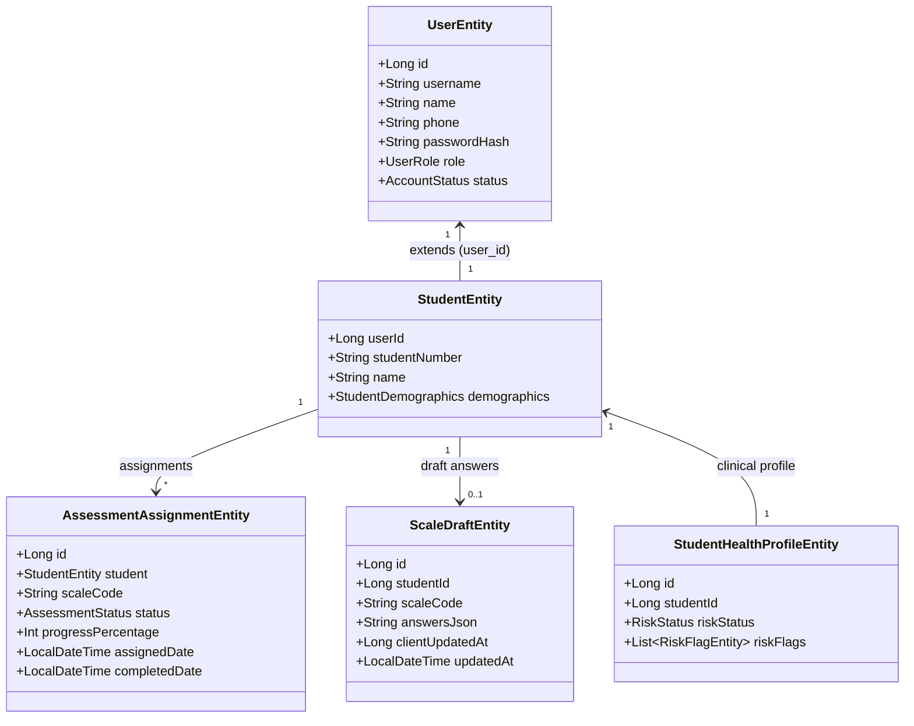

# Architecture Specification: Mobile Intake & Medical System Unified Monorepo Integration

## 1. Executive Summary & Strategy
This document defines the architectural specification for integrating `/Volumes/Files/Programming/mobile-intake` into the University Medical Screening System (`/Volumes/Files/Programming/medical-system`).

Following the user's explicit design directives:
1. **Unified Monorepo Architecture**: Move mobile intake frontend to `/mobile` inside `medical-system`. Mobile intake directly consumes the Spring Boot backend REST APIs (`/api/*`) and MySQL 8 database. No separate microservice, SQLite, or background sync jobs.
2. **Fresh Start**: Legacy SQLite database (`intake.db`) is not migrated; MySQL serves as the single source of truth.
3. **Single Unified Assessment**: Replace the 8 separate scale batteries with the single 377-question, 30-subscale milestone assessment (`comprehensive_student_intake_survey`).
4. **Unified Authentication & Dual Login**: Student registration creates both `UserEntity` (role `STUDENT`, BCrypt password) and `StudentEntity` in MySQL. Students can log in to both mobile intake and the main portal with the same credentials (`studentNumber` or `phone` + `password`).
5. **Dual-Mode SMS OTP**: Dev/test mode uses `MockSmsSender` (returning `devCode` in response); production uses Aliyun SMS.
6. **Referral Workflow**: Mobile intake UI is kept as-is. Students view their referrals in the main medical system web portal using their unified account.
7. **Extensible Clinical Triage Boilerplate**: Provide a pluggable `ClinicalRiskEvaluator` that detects acute risk items (e.g., `ghq_22=1` suicidal ideation), escalates risk to `HIGH`, appends risk flags, and alerts councillors.

---

## 2. Monorepo Directory Layout

```text
/Volumes/Files/Programming/medical-system/
├── backend/                       # Spring Boot 4.1 + Kotlin 2.3 + MySQL REST API (Port 8080)
│   ├── src/main/resources/
│   │   ├── assessments/           # 30 scale JSONs + assessment_groups.json + shared options
│   │   └── application.properties # Aliyun SMS & DB configs
├── frontend/                      # Desktop / Administrative Web Portal (Port 3000)
├── mobile/                        # Mobile-First Responsive Web Intake SPA (Port 3005)
│   ├── package.json
│   ├── vite.config.ts             # Proxy /api -> http://localhost:8080
│   └── src/
│       ├── StudentApp.tsx         # Mobile intake entry point
│       └── pages/                 # Questionnaire player, profile, login
└── docker-compose.yml             # Orchestration for db, backend, frontend, and mobile
```

---

## 3. Database Schema & Domain Model (MySQL 8)

### 3.1 Entity Relationship Diagram



### 3.2 Table Schema Specifications

#### `users` Table Modifications:
- Add `phone VARCHAR(32) NULL UNIQUE`
- Add `password_hash VARCHAR(255) NULL`

#### New `scale_drafts` Table:
```sql
CREATE TABLE IF NOT EXISTS scale_drafts (
    id BIGINT UNSIGNED AUTO_INCREMENT PRIMARY KEY,
    student_id BIGINT UNSIGNED NOT NULL,
    scale_code VARCHAR(64) NOT NULL,
    answers_json MEDIUMTEXT NOT NULL,
    client_updated_at BIGINT NOT NULL,
    updated_at TIMESTAMP NOT NULL DEFAULT CURRENT_TIMESTAMP ON UPDATE CURRENT_TIMESTAMP,
    UNIQUE KEY uk_student_scale (student_id, scale_code),
    INDEX idx_student_id (student_id)
) ENGINE=InnoDB DEFAULT CHARSET=utf8mb4 COLLATE=utf8mb4_unicode_ci;
```

---

## 4. Assessment Catalog & Engine Architecture

### 4.1 Catalog Replacement
- Replace old fragmented scales (`phq_9.json`, `gad_7.json`, `scl_90.json`, etc.) with the 30 standardized scales from `mobile-intake`:
  - `demographics_survey.json` (58 items, basic & lifestyle demographics)
  - `general_health_screener.json` (24 items, GHQ-12 + clinical referral items including `ghq_22`)
  - 28 psychological subscales (`phq_9`, `gad_7`, `sleep_disorder`, `life_events`, `peer_relationship`, `aggression`, `impulsivity`, `childhood_ses`, `self_control`, `loneliness`, `childhood_trauma`, `apq_9_father`, `apq_9_mother`, `nssi`, `social_support`, `emotion_regulation`, `grit`, `coping_styles`, `swls`, `mobile_addiction`, `game_addiction`, `pq16`, `adhd`, `big_five`, `brief_a`, `procrastination`, `eating_habits`, `teacher_relationship`).
- Single `assessment_groups.json` registering:
  - Code: `comprehensive_student_intake_survey`
  - Title: `中南大学学生心身健康综合调查问卷`
  - Total items: 377

### 4.2 Polymorphic Question Schema Support
Update `AssessmentScale.kt` and loader:
```kotlin
data class AssessmentQuestion(
    val id: String,
    val text: String,
    val type: String? = "single_choice", // single_choice, multiple_choice, slider, number, text, date
    val min: Double? = null,
    val max: Double? = null,
    val step: Double? = null,
    val unit: String? = null,
    val options: List<AssessmentOption> = emptyList(),
    val required: Boolean = true
)

data class AssessmentOption(
    val value: Any, // Can be Int or String
    val label: String,
    val hasTextInput: Boolean = false,
    val textInputLabel: String? = null
)
```

---

## 5. API Contracts

### 5.1 Authentication & Registration (`AuthController.kt`)

#### `POST /api/auth/send-code`
- **Request**: `{ "phone": "13800000000" }`
- **Response**: `{ "success": true, "devCode": "123456" }` (in dev/test profile)

#### `POST /api/auth/student-register`
- **Request**:
  ```json
  {
    "studentNumber": "STU2026999",
    "fullName": "张明",
    "phone": "13800000000",
    "password": "Password123",
    "verificationCode": "123456"
  }
  ```
- **Action**:
  - Validates OTP via `OtpService`.
  - Creates `UserEntity(role=STUDENT, passwordHash=BCrypt(password), phone=phone)`.
  - Creates `StudentEntity(userId=user.id, studentNumber=studentNumber, name=fullName)`.
  - Creates initial `StudentHealthProfileEntity`.
  - Assigns `comprehensive_student_intake_survey` via `AssessmentAssignmentEntity`.
- **Response**:
  ```json
  {
    "token": "jwt-token-string",
    "user": {
      "id": 100,
      "username": "STU2026999",
      "name": "张明",
      "role": "STUDENT"
    }
  }
  ```

#### `POST /api/auth/login` (Unified Password Login)
- **Request**: `{ "identifier": "STU2026999" /* or phone */, "password": "Password123" }`
- **Action**: Matches by `username` or `phone`, verifies `BCrypt.checkpw`.
- **Response**: Session / JWT token and user details.

---

### 5.2 Draft & Assessment Sync (`AssessmentController.kt`)

#### `GET /api/assessments/my-assignments`
- **Action**: Returns active assignment for the authenticated student.
- **Response**:
  ```json
  [
    {
      "id": 1,
      "scaleCode": "comprehensive_student_intake_survey",
      "title": "中南大学学生心身健康综合调查问卷",
      "status": "IN_PROGRESS",
      "progressPercentage": 45,
      "totalQuestions": 377,
      "answeredQuestions": 170
    }
  ]
  ```

#### `GET /api/assessments/{assignmentId}/draft`
- **Action**: Returns saved answers from `scale_drafts`.
- **Response**: `{ "answers": { "phq9_1": 2, ... }, "clientUpdatedAt": 1729600000000 }`

#### `PUT /api/assessments/{assignmentId}/draft`
- **Request**: `{ "answers": { ... }, "clientUpdatedAt": 1729600001000 }`
- **Action**: Upserts into `scale_drafts`, recalculates `progressPercentage` on `AssessmentAssignmentEntity`.
- **Response**: `{ "progressPercentage": 45, "savedCount": 170 }`

#### `POST /api/assessments/{assignmentId}/submit`
- **Request**: `{ "answers": { ... } }`
- **Action**:
  - Updates assignment status to `COMPLETED`.
  - Purges draft from `scale_drafts`.
  - Demographics Projection: populates `StudentDemographicsEntity` from `demographics_survey` answers.
  - Publishes `AssessmentCompletedEvent`.
- **Response**: `{ "success": true, "completedAt": "2026-10-22T23:00:00" }`

---

## 6. Extensible Clinical Risk Evaluation Boilerplate

```kotlin
@Component
class ClinicalRiskEvaluator(
    private val studentHealthProfileRepository: StudentHealthProfileRepository,
    private val notificationService: NotificationService
) {
    fun evaluate(studentId: Long, assignmentId: Long, rawAnswers: Map<String, Any>) {
        val acuteFlags = mutableListOf<RiskFlagName>()

        // 1. Critical suicidal ideation / crisis screening items
        val suicideIdeation = rawAnswers["ghq_22"]?.toString()?.toIntOrNull() == 1
        val suicideAttempt = rawAnswers["ghq_23"]?.toString()?.toIntOrNull() == 1
        val phq9Crisis = (rawAnswers["phq9_9"]?.toString()?.toIntOrNull() ?: 0) >= 1

        if (suicideIdeation || phq9Crisis) {
            acuteFlags.add(RiskFlagName.SUICIDAL_IDEATION)
        }
        if (suicideAttempt) {
            acuteFlags.add(RiskFlagName.SUICIDE_ATTEMPT)
        }

        // 2. Extensible Subscale Scoring Hook (Placeholder for hospital custom models)
        val subscaleScores = calculateSubscaleScores(rawAnswers)

        // 3. Risk Status Escalation
        val riskStatus = when {
            acuteFlags.isNotEmpty() -> RiskStatus.HIGH
            subscaleScores.phq9Score >= 15 -> RiskStatus.HIGH
            subscaleScores.phq9Score >= 10 -> RiskStatus.MEDIUM
            else -> RiskStatus.NORMAL
        }

        // 4. Update Profile & Alert Councillors
        val profile = studentHealthProfileRepository.findByStudentId(studentId)
        if (riskStatus == RiskStatus.HIGH) {
            profile.escalateRisk(RiskStatus.HIGH, acuteFlags)
            notificationService.publishAlert(
                type = NotificationType.ASSESSMENT_HIGH_RISK_ALERT_HC,
                targetRole = UserRole.HEAD_COUNSELLOR,
                studentId = studentId
            )
        }
    }

    private fun calculateSubscaleScores(answers: Map<String, Any>): SubscaleScores {
        val phq9 = (1..9).sumOf { answers["phq9_$it"]?.toString()?.toIntOrNull() ?: 0 }
        val gad7 = (1..7).sumOf { answers["gad7_$it"]?.toString()?.toIntOrNull() ?: 0 }
        return SubscaleScores(phq9Score = phq9, gad7Score = gad7)
    }
}
```

---

## 7. Mobile Frontend Configuration

- `/mobile/vite.config.ts`:
  ```typescript
  export default defineConfig({
    plugins: [react(), tailwindcss()],
    server: {
      port: 3005,
      proxy: {
        '/api': {
          target: 'http://localhost:8080',
          changeOrigin: true
        }
      }
    }
  });
  ```
- Authentication in `mobile/src/api/client.ts`: attaches `Authorization: Bearer ${localStorage.getItem('mobile_intake_token')}` on all requests.
