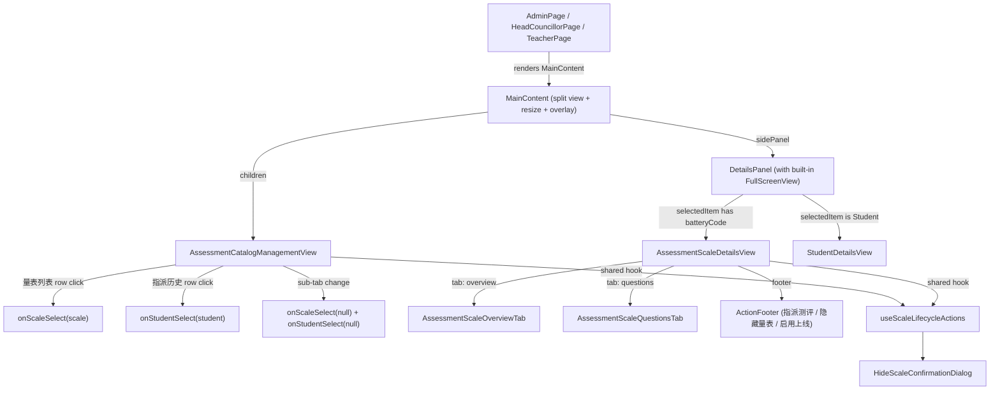

# Architecture Specification: Assessment Scale DetailsPanel Rework

## 1. Human Intent Lock

1. **Scope across Roles**: Rework the `测评量表` (`Assessments`) tab (`AssessmentCatalogManagementView`), present in `AdminPage`, `HeadCouncillorPage`, and `TeacherPage`, so clicking an assessment row in `量表列表` opens the right-hand `DetailsPanel` (inside `MainContent`) instead of `AssessmentScaleDetailsFullScreen`.
2. **Panel Structure (2 Tabs)**:
   - **概览 (`overview`)**: Scale metadata (`batteryCode`, `title`, `subtitle`, `description`, availability status, question count, estimated duration, section count) and a summary of all sections.
   - **量表题目 (`questions`)**: Collapsible section cards (first section expanded by default, with expand-all / collapse-all toggle) displaying each question's number, text, type badge, and options/range/unit/placeholder preview, optimized for large scales (e.g., 377 questions).
3. **Footer & Row Actions**:
   - Keep inline table row quick-actions (`指派测评`, `隐藏量表` / `启用上线`) AND include these actions in the `DetailsPanel` footer (`ActionFooter`) across all three roles (`Admin`, `Head Councillor`, `Teacher`).
   - Clicking `指派测评` opens `AssessmentAssignmentCreationForm` in `CreationContext` (disabled when scale is hidden).
   - Clicking `隐藏量表` opens the existing confirmation dialog (`确认隐藏测评量表？` with compliance details); clicking `启用上线` immediately toggles availability.
   - Toggling availability updates both the catalog query cache and the open `DetailsPanel` state immediately.
4. **Fullscreen & Cleanup**:
   - Use `DetailsPanel`'s built-in `open_in_full` -> `FullScreenView` expansion (tabs move to sidebar, `ActionFooter` portals to `#fullscreen-header-actions`).
   - Remove the obsolete placeholder `AssessmentScaleDetailsFullScreen` and its test file.

---

## 2. Backend & MSW API Contract Verification

- **Endpoint**: `GET /api/assessments/catalog` (`AssessmentController.kt` -> `AssessmentService.getCatalog()` -> `AssessmentMapper.toCatalogItemDto()`) and MSW handler (`frontend/src/mocks/handlers.ts` -> `mockAssessmentCatalog` in `frontend/src/mocks/data/assessments.ts`).
- **Payload (`AssessmentCatalogItemDto`)**: Both the Spring Boot backend and MSW mocks already return full `sections: AssessmentSectionDto[]` and nested `questions: AssessmentQuestionDto[]` on `/api/assessments/catalog`. No backend API additions or extra detail fetches are required.
- **Availability Toggle**: `PUT /api/assessments/catalog/:batteryCode/availability` (`toggleScaleAvailability` in `frontend/src/api/admin.ts`, consumed by `useAssessmentCatalogManagement.ts`). No backend RBAC changes are required for this frontend rework; `useAssessmentCatalogManagement` surfaces any API error (such as 403) via `useSnackbar()`.

---

## 3. Component Architecture & Data Flow

### Key Architectural Decisions

1. **Native `MainContent` + `DetailsPanel` Integration**:
   - Host pages (`AdminPage`, `HeadCouncillorPage`, `TeacherPage`) render `DetailsPanel` in `MainContent`'s `sidePanel` slot, preserving the sibling split-card layout, drag-to-resize handle, `< 1024px` overlay mode, and `open_in_full` expansion.
   - For the `Assessments` page tab, `selectedItem` can be either an `AssessmentCatalogItemDto` (from `量表列表`) or a `Student` (from `指派历史`), distinguished via a strict type guard `isAssessmentScale(item)` (`Boolean(item && 'batteryCode' in item)`).
   - Shared helper functions in `frontend/src/components/assessments/assessmentPanelConfig.tsx` compute the `DetailsPanel` props (`title`, `subtitle`, `icon`, `headerAvatar`, `tabs`, `badge`) and render the body (`AssessmentScaleDetailsView` vs `StudentDetailsView`) uniformly across `AdminPage`, `HeadCouncillorPage`, and `TeacherPage` without duplicating conditional JSX.

2. **Live Cache Synchronization**:
   - `AssessmentScaleDetailsView` reads the live scale entry from `useAssessmentCatalogManagement().catalog.find(s => s.batteryCode === scale.batteryCode) ?? scale`.
   - When `toggleAvailability` succeeds (whether triggered from a table row icon or the panel footer), React Query invalidates `['assessments', 'catalog']`, immediately updating the status pill (`正常可用` / `已隐藏`), disabling/enabling `指派测评`, and toggling the footer button (`隐藏量表` / `启用上线`).

3. **Shared Lifecycle Hook & Extracted Confirmation Dialog**:
   - `useScaleLifecycleActions()` encapsulates `handleOpenAssign(scale)`, `requestToggleAvailability(scale)`, `pendingHideScale`, `cancelHideScale`, `confirmHideScale`, and `isToggling`.
   - `HideScaleConfirmationDialog` extracts the `GenericDialog` (`确认隐藏测评量表？`) and its collapsible compliance consequences from `AssessmentCatalogManagementView` so both table rows and `AssessmentScaleDetailsView` reuse it without code duplication.

4. **Performance for Large Scales (377+ Questions)**:
   - `AssessmentScaleQuestionsTab` initializes `expandedSectionIds` to `new Set(sections[0] ? [sections[0].id] : [])` and resets it when `scale.batteryCode` changes.
   - Collapsed sections do not mount question DOM nodes (`{isExpanded && (...)}`), keeping initial render lightweight.
   - `QuestionPreviewCard` is wrapped in `React.memo` and uses pure CSS/Tailwind styling with MD3 CSS variables (`--md-sys-color-*`).

5. **MD3 & Code Quality Rules**:
   - Strictly zero native `<input>`, `<textarea>`, or `<select>` elements.
   - Uses `SecondaryTabs`, `ScrollableDetailsLayout`, `DetailsSection`, `GroupedInfoList`, `ActionFooter`, `PrimaryButton`, `OutlinedButton`, `TertiaryButton`, and `GenericDialog`.
   - Defensive fallbacks (`sections ?? []`, `options ?? []`) throughout.
